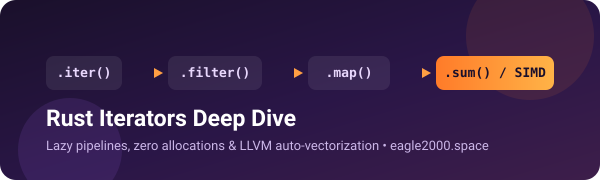

<p align="center">
  
</p>

<p align="center">
  <b>🇬🇧 English</b> | <a href="README.ru.md">🇷🇺 Русский</a>
</p>

# 🦀 Rust Iterators Deep Dive — Companion Examples

This repository is the practical code companion for the **Rust Iterators Deep Dive** article on **[eagle2000.space](https://eagle2000.space/en/rust/rust-iterators-deep-dive/)**.  
Here you will find runnable examples and a comparative benchmark showing how lazy iterator pipelines avoid heap allocations and compile down to tight loops and SIMD instructions.

---

## 📖 Blog Article & Live Assembly

* 📖 **Read the full article:** [Rust Iterators: Lazy Data Processing Without Extra Allocations](https://eagle2000.space/en/rust/rust-iterators-deep-dive/) *(or in [Russian](https://eagle2000.space/rust/rust-iterators-deep-dive/))*
* ⚙️ **Inspect ARM64 assembly on Godbolt (`rustc 1.95.0 -O`):** [godbolt.org/z/Kjh19eMv8](https://godbolt.org/z/Kjh19eMv8)

---

## 💡 The Core Idea

In eager languages or naive collection pipelines, chaining `.filter()` and `.map()` allocates a fresh temporary array at every step. In Rust, `.iter().filter(...).map(...)` does **zero work** and allocates **zero heap memory** until a terminal method (`.collect()`, `.sum()`, `for`) pulls items through the pipeline one by one.

---

## 📂 What's Inside `src/bin`

| Binary | Topic | Notes |
| :--- | :--- | :--- |
| **`01_for_and_modes.rs`** | `.iter()`, `.iter_mut()`, `.into_iter()` | How `for` desugars into `IntoIterator::into_iter` |
| **`02_lazy_and_size.rs`** | Laziness & stack layout | Prints `size_of_val` and `type_name_of_val` of `Map<Iter<...>>` without running closures |
| **`03_short_circuit.rs`** | Short-circuiting | `collect::<Result<Vec<_>, _>>()` stops on the first `Err` |
| **`04_by_ref.rs`** | `.by_ref()` | Consuming a header with `.take(2)` while keeping the iterator alive |
| **`05_retry_backoff.rs`** | Custom `Iterator` | Exponential backoff schedule implementing `Iterator` + `FusedIterator` |
| **`06_page_iter.rs`** | Lazy pagination | Paginated API fetcher backed by `VecDeque` |
| **`07_from_fn_and_windows.rs`** | Stdlib idioms | `std::iter::from_fn`, `-> impl Iterator`, and `slice.windows(2)` |
| **`08_sum_pos_asm.rs`** | LLVM & SIMD | Standalone `sum_pos` function matching the Godbolt disassembly |
| **`09_benchmark_comparison.rs`** | **Comparative benchmark** | Compares eager intermediate `Vec`s vs lazy iterator chain vs plain `for` loop |

---

## 📊 Benchmark Results (10,000,000 `i32` Elements, ~40 MB)

Measured in release mode (`cargo run --release --bin 09_benchmark_comparison`):

| Approach | Execution Time | Intermediate Allocations |
| :--- | :--- | :--- |
| **1. Eager intermediate `Vec`s (`collect` per step)** | ~46.1 ms | 2 heap vectors |
| **2. Lazy iterator chain (`.filter().map().sum()`)** | **~2.4 ms** | **0 allocations** 🏆 |
| **3. Manual `for` loop** | **~0.92 ms** | **0 allocations** |

> **Takeaway:** Avoiding intermediate allocations with a lazy iterator chain delivers an ~19x speedup over eager step-by-step `Vec` collection while keeping memory overhead at zero.

---

## ⚠️ When a Plain `for` Loop Is Better

1. **Complex control flow:** Early returns from the outer function, `break` with a value, or `continue` across nested loops are cleaner with `for`.
2. **Multiple mutable borrows / `Result` + side effects:** When `try_fold` or `scan` becomes hard to read, a `for` loop is more idiomatic.
3. **Mutating two collections in lockstep with conditional branching:** Explicit loops stay easier to debug and review.

---

## 🚀 Quick Start

```bash
# Clone the repository
git clone https://github.com/eaglebk/rust-iterators-examples.git
cd rust-iterators-examples

# Run the comparative benchmark
cargo run --release --bin 09_benchmark_comparison

# Or run individual examples:
cargo run --release --bin 02_lazy_and_size
cargo run --release --bin 06_page_iter
cargo run --release --bin 08_sum_pos_asm
```

---

## 🔗 Useful Links

* 📖 Rust Docs: [`std::iter::Iterator`](https://doc.rust-lang.org/std/iter/trait.Iterator.html)
* 📖 Rust Docs: [`std::iter::from_fn`](https://doc.rust-lang.org/std/iter/fn.from_fn.html)
* 🌐 Blog: **[eagle2000.space](https://eagle2000.space/en/)** — interactive tutorials on Rust, mobile engineering, and visual arts
* ✈️ Telegram: **[@prog_lighthouse](https://t.me/prog_lighthouse)** — «Маяк Программиста» `[RU]`
* 📺 YouTube: **[@prog_lighthouse](https://www.youtube.com/@prog_lighthouse)** — Programmer's Lighthouse `[RU]`

---

## 📄 License

MIT © Konstantin ([@eaglebk](https://github.com/eaglebk))
