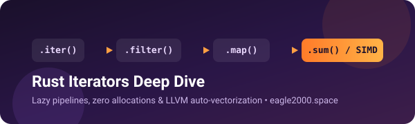

<p align="center">
  
</p>

<p align="center">
  <a href="README.md">🇬🇧 English</a> | <b>🇷🇺 Русский</b>
</p>

# 🦀 Итераторы в Rust — Примеры кода

Этот репозиторий содержит запускаемые примеры и бенчмарк к статье об устройстве итераторов в Rust на **[eagle2000.space](https://eagle2000.space/rust/rust-iterators-deep-dive/)**.  
Здесь собраны все листинги из выпуска: от разворачивания цикла `for` и ленивых цепочек до собственного итератора пагинации и проверки ассемблера LLVM.

---

## 📖 Статья и разбор ассемблера

* 📖 **Читать статью:** [Итераторы в Rust: ленивая обработка данных без лишних аллокаций](https://eagle2000.space/rust/rust-iterators-deep-dive/) *(версия на [английском](https://eagle2000.space/en/rust/rust-iterators-deep-dive/))*
* ⚙️ **Проверить ARM64-ассемблер на Godbolt (`rustc 1.95.0 -O`):** [godbolt.org/z/Kjh19eMv8](https://godbolt.org/z/Kjh19eMv8)

---

## 💡 Главная идея

В «жадных» цепочках на каждом шаге `.filter()` или `.map()` в куче создаётся новый промежуточный массив. В Rust вызов `.iter().filter(...).map(...)` не запускает вычислений и не выделяет память под промежуточные коллекции: элементы проходят через всю цепочку по одному в момент вызова терминального метода (`.collect()`, `.sum()`, `for`).

---

## 📂 Что внутри `src/bin`

| Файл | Тема | Описание |
| :--- | :--- | :--- |
| **`01_for_and_modes.rs`** | `.iter()`, `.iter_mut()`, `.into_iter()` | Три режима итерации и разворачивание `for` через `IntoIterator` |
| **`02_lazy_and_size.rs`** | Ленивость и стек | Размер обёртки `Map<Iter<...>>` на стеке без запуска замыканий |
| **`03_short_circuit.rs`** | Short-circuiting | `collect::<Result<Vec<_>, _>>()` останавливается на первой ошибке |
| **`04_by_ref.rs`** | `.by_ref()` | Отделение заголовка через `.take(2)` без потери итератора |
| **`05_retry_backoff.rs`** | Свой `Iterator` | Экспоненциальная задержка с `Iterator` + `FusedIterator` |
| **`06_page_iter.rs`** | Ленивая пагинация | Постраничная загрузка с буфером `VecDeque` |
| **`07_from_fn_and_windows.rs`** | Идиомы stdlib | `std::iter::from_fn`, `-> impl Iterator` и `slice.windows(2)` |
| **`08_sum_pos_asm.rs`** | LLVM и SIMD | Функция `sum_pos` для сверки ассемблера на Godbolt |
| **`09_benchmark_comparison.rs`** | **Сравнительный бенчмарк** | Жадные промежуточные `Vec` vs ленивая цепочка vs обычный цикл `for` |

---

## 📊 Результаты замеров (10 000 000 элементов `i32`, ~40 МБ)

Замер в релизной сборке (`cargo run --release --bin 09_benchmark_comparison`):

| Подход | Время выполнения | Промежуточные аллокации |
| :--- | :--- | :--- |
| **1. Жадные промежуточные `Vec` (`collect` на шаге)** | ~46.1 мс | 2 вектора в куче |
| **2. Ленивая цепочка (`.filter().map().sum()`)** | **~2.4 мс** | **0 аллокаций** 🏆 |
| **3. Обычный цикл `for`** | **~0.92 мс** | **0 аллокаций** |

> **Вывод:** отказ от промежуточных векторов с помощью ленивой цепочки итераторов даёт ускорение примерно в 19 раз при нулевых лишних аллокациях.

---

## ⚠️ Когда обычный `for` лучше

1. **Сложный поток управления:** ранний `return` из внешней функции, `break` со значением или ветвление во вложенных циклах.
2. **Множественные мутабельные заимствования и побочные эффекты:** когда `try_fold` или `scan` превращаются в головоломку.
3. **Удобство отладки:** обычный `for` легче читать и сопровождать, если логика ветвится слишком сильно.

---

## 🚀 Быстрый старт

```bash
# Клонировать репозиторий
git clone https://github.com/eaglebk/rust-iterators-examples.git
cd rust-iterators-examples

# Запустить сравнительный бенчмарк
cargo run --release --bin 09_benchmark_comparison

# Или запустить отдельные примеры:
cargo run --release --bin 02_lazy_and_size
cargo run --release --bin 06_page_iter
cargo run --release --bin 08_sum_pos_asm
```

---

## 🔗 Полезные ссылки

* 📖 Документация Rust: [`std::iter::Iterator`](https://doc.rust-lang.org/std/iter/trait.Iterator.html)
* 📖 Документация Rust: [`std::iter::from_fn`](https://doc.rust-lang.org/std/iter/fn.from_fn.html)
* 🌐 Блог: **[eagle2000.space](https://eagle2000.space/)** — статьи по Rust, мобильной разработке и фотографии
* ✈️ Telegram: **[@prog_lighthouse](https://t.me/prog_lighthouse)** — «Маяк Программиста»
* 📺 YouTube: **[@prog_lighthouse](https://www.youtube.com/@prog_lighthouse)** — «Маяк Программиста»

---

## 📄 Лицензия

MIT © Konstantin ([@eaglebk](https://github.com/eaglebk))
